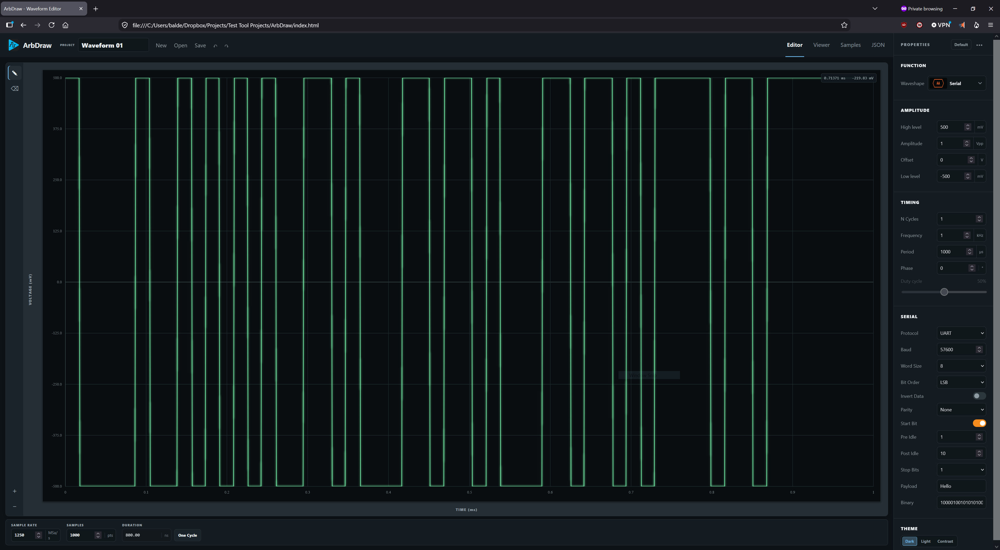

# ArbDraw

Vibe coded, but actually useful, arbitrary waveform editor.

[](https://baldengineer.github.io/arbdraw/)

## Try it online

Access the GitHub-hosted version at [baldengineer.github.io/arbdraw](https://baldengineer.github.io/arbdraw/).

## Run

No build step or dependency installation is required to open `index.html` directly from disk. The GitHub Pages workflow stamps the published copy's CSS and JavaScript URLs with the deployment commit SHA, so browsers fetch updated assets after each deployment.

Opening `index.html` as a `file://` page supports waveform editing, saving, and exporting, but cannot connect to the Python instrument bridge. For instrument discovery, Identify, and Send to AWG, use the hosted app or serve your local copy as described below.

For GitHub Pages publication, set **Settings → Pages → Build and deployment → Source** to **GitHub Actions**. The `Publish ArbDraw` workflow builds and deploys the stamped site on each push to `main`.

ArbDraw loads the pinned MIT-licensed Driver.js 1.8.0 browser distribution from jsDelivr for its first-run product tour. If the CDN is unavailable, it automatically falls back to the vendored copy, so the tour also works when `index.html` is opened directly from disk. The upstream license is retained in [`vendor/driver.js/1.8.0/LICENSE`](vendor/driver.js/1.8.0/LICENSE).

## Python instrument bridge

The **Send to AWG** command connects ArbDraw to a local Python REST service. From the app, users can discover VISA resources, issue `*IDN?`, and send the current waveform to a configured instrument adapter.

Download `arbdraw-bridge-with-adapters-<version>.zip` from the [Python bridge releases](https://github.com/baldengineer/arbdraw/releases), extract it, and run `python install.py` with Python 3.11 or newer. This installs the bridge and all supported instrument adapters into the same Python environment. On Windows, run `arbdraw-bridge-tray.exe` for notification-area controls. On macOS, run `arbdraw-bridge-menubar` for equivalent menu bar controls. Both status menus report the bridge version and available adapters. Their icons are grey while inactive and blue after confirming the bridge is running. On other platforms, use `python -m python_bridge`. See [python_bridge/README.md](python_bridge/README.md) for platform-specific setup, single-adapter installation, VISA setup, source installation, and API details.

### Use instruments with a local copy

After installing the bridge and the required instrument adapter, open a terminal in the ArbDraw source folder containing `index.html` and run:

```powershell
python -m python_bridge --serve-app .
```

Open [http://127.0.0.1:8876](http://127.0.0.1:8876) in your browser, then choose **File → Send to AWG** and connect using the same bridge URL. Keep the terminal running while using the app. The `.` means the current ArbDraw source folder, not the extracted bridge installer folder. If a tray/menu-bar bridge is already using port 8876, stop it before starting this command.

This replaces direct `file://` instrument access: browsers give local files an opaque origin that the bridge cannot distinguish from untrusted pages, so it rejects them before any instrument command runs. Save your current waveform as JSON before switching pages, then reopen it in the served app. Browser preferences are stored separately for different origins.

The [hosted ArbDraw app](https://baldengineer.github.io/arbdraw/) remains supported with the usual `python -m python_bridge` command or tray/menu-bar launcher; it does not require `--serve-app`. Other web servers require an explicit trusted `--allow-origin` including the port. See the [bridge connection instructions](python_bridge/README.md#connect-arbdraw).

### TekScope MSO2 and MSO6

The shared TekScope package registers separate `tekscope-mso2` and
`tekscope-mso6` waveform backends. To install only that package from the release
bundle, run:

```powershell
python .\install.py --adapter tekscope
python -m python_bridge --idn 192.168.128.233
python -m python_bridge
```

Replace the example IP with the scope's address. In ArbDraw, select the matching
**TekScope MSO2 (files)** or **TekScope MSO6 (files)** AWG profile, then use
**File → Send to AWG** to identify the scope and send the waveform. The MSO2
backend includes a firmware-specific file-write limit; the MSO6 backend has
been verified with waveforms up to 100,000 points. See the [TekScope adapter guide](https://github.com/baldengineer/tekscope-arbdraw-adapter#readme)
for supported models, VISA setup, file behavior, limitations, and
troubleshooting.


## Features

- Sine, square, pulse, triangle with adjustable symmetry (including rising/falling ramps), RC charging curves, white/pink noise, and serial (UART) waveform types
- Fixed, evenly spaced voltage points (with frequency and period stored as instrument metadata)
- Generator profiles, including Audio at 48 kHz with 1,000 default points and a 100,000-point maximum
- CSV export with optional waveform metadata headers
- SVG export with black lines on a transparent background and optional time/voltage axes and grid
- WAV export as mono 16-bit PCM at the current sample rate, with peak normalization (use the Audio profile for 48 kHz)
- Browser audio playback with a Play/Stop control and automatic output-rate conversion
- Optional noise and smoothing filters with checkbox and value controls in Advanced mode Properties
- Undo and redo for waveform changes
- Sequences with independent segment sources, sample counts, and waveform previews
- Freehand and erase editing within optional selection markers
- Waveform Viewer (to simulate what you'd see on an oscilloscope)
- Serial pulse-train generation from protocol, baud, word size, parity, framing, and payload controls
- Adjustable rise and fall times for square, pulse, and serial waveforms, with linear ramps limited by the next opposite edge

## Editing modes

New projects open in **Basic**, where you choose a waveshape and adjust its properties. Switch to **Advanced** above the editor canvas to select or draw points and use filters. Returning to Basic after advanced edits or filters asks for confirmation, then regenerates the waveform from its properties and discards those advanced changes. Projects with point edits or active filters open in Advanced. Sample values can be changed in the Samples view only while Advanced is active. Theme and waveform rendering are available from the View menu.

## Sequences

Select **Add Segments** beside **Full Record**, then choose a waveshape to enter Arbitrary mode and create two segments: the current source and a new segment with the chosen shape. The AWG's current total point count is divided equally between them. Each **+** addition opens the waveshape menu for the new segment, inheriting other settings from the selected segment (or the last segment while viewing the full record), then redistributes the total points across all segments and regenerates their waveforms. Any leftover whole points are assigned to the first segments. If any existing waveform has arbitrary sample edits, a confirmation warns that those edits will be lost; canceling keeps the waveform unchanged.

The segment cards sit above the full-record overview. Select a card to edit that segment's waveshape, voltage levels, timing, filters, or individual points. Each segment has its own sample-count input. Use **×** to remove a segment.

Both **+** and **Add Segments** use the same waveshape menu as the waveform source dropdown. Clicking a button or focusing it and pressing **↓** opens the menu; a segment is added only after choosing a shape. Dismissing the menu leaves the sequence unchanged.

Click the full-record overview or **Full Record** to see the combined sequence. This view is read only; select a card to resume editing. The Viewer, browser playback, and Send to AWG use the complete sequence. Under **File → Export Waveform**, choose **Full Record** to export everything or **Segment X** to export the selected segment as CSV, SVG, or WAV. The segment choice appears only while a segment is selected. Undo/redo and project JSON preserve the segments and their sources.

A sequence uses one sample clock, established from the original waveform's sample count and AWG output period. Changing a segment's sample count changes its frequency; changing its frequency or cycle count adjusts its sample count at that clock. Timing is rounded to whole samples and constrained by the AWG profile's total record limit. The AWG frequency and period describe repetition of the complete sequence. Choose the AWG profile before adding segments; it remains fixed until the sequence is removed. WAV export still requires a supported sample rate.

Removing all but one segment returns to a single waveform. Switching to Basic asks before discarding the sequence and keeps the selected segment, or the first segment in full-record view.

## Menu styling

Use `ARBDRAW_MENU` from `js/menus.js` for menus built in JavaScript. `create({ id, label, className })` creates a menu surface, `item({ text, onClick })` creates an action, `item({ text, externalHref })` creates a link that opens in a new window, and `separator()` creates a divider. Use `prepareItem(element, role)` when moving an existing button into a menu, and `setOpen(menu, trigger, open)` to keep visibility and `aria-expanded` together. The helper supplies item roles and button types; callers supply placement and actions. For menus in HTML, use `menu-surface` and semantic roles. `includes/menus.css` styles menu buttons and links even if a role is accidentally omitted. Add `menu-trigger` to labeled menu buttons and `menu-select` to native `<select>` controls.

```js
const menu = ARBDRAW_MENU.create({ id: 'toolsMenu', label: 'Tools' });
menu.append(ARBDRAW_MENU.item({ text: 'Refresh', onClick: refreshTools }));
```

## ArbDraw Files

The editor keeps a versioned `arbdraw.waveform` document in memory as its source of truth.

## URL parameters

The initial waveform can be selected and configured from the URL. URL parameters override saved browser settings. For example:

`?waveshape=triangle&frequencyHz=1000&nCycles=2&symmetryPercent=25`

For an RC charging curve, `rcTau` sets the number of time constants shown in each cycle (default 5); `tau` is accepted as a URL alias. Since `τ = R × C`, five time constants charge the capacitor from the low level to about 99.3% of the high level.

Parameters use the same names as the editable defaults in `js/defaults.js`. `wave`, `waveshape`, `waveform`, and `type` are aliases for `waveformType`; `frequency` and `period` are aliases for `frequencyHz` and `periodSeconds`. If both frequency and period are supplied, frequency takes precedence so the linked controls remain synchronized.

Use `?onboard=1` to force the getting-started tour to open or `?onboard=0` to suppress its automatic first-run launch. The tour can always be started again from **Help → Getting started**.

Use `?mode=arbitrary` to open the editor in Arbitrary mode. Selecting Arbitrary adds this parameter to the current URL so the editing mode can be bookmarked; returning to Basic removes it.

Driver.js uses the CDN by default. Add `?driver=local` to use the vendored JavaScript and CSS without attempting a network request.

- Use **Save** to download an `.arbdraw.json` project containing waveform parameters and sample values.
- Use **Open** to restore a project from a JSON file or pasted JSON text.

See [ArbDraw_JSON_Format.md](ArbDraw_JSON_Format.md) for the complete field reference, units, import rules, timing formulas, and a Python reader example.

(Transient UI state such as the selected drawing tool, zoom, and undo history is intentionally not stored in the project document.)

## Exporting waveforms

Choose **File → Export Waveform → Full Record** (or **Segment X** while a segment is selected), select **CSV**, **SVG**, or **WAV**, and enter a filename. Segment exports start their time axis at zero and retain the shared sequence sample rate. Their filenames include the segment number, and updating the project name is unchecked by default.

- **CSV** exports voltage samples with an optional metadata header and a timestamp column that is included by default but can be omitted. The timestamp choice is remembered until you create a new project or reset all settings.
- **SVG** exports black waveform lines on a transparent background, with optional axes and grid.
- **WAV** exports the current samples as mono, 16-bit PCM audio. Sample values are normalized so the largest absolute value reaches full scale; silence remains silent.

### Audio and WAV export

1. Select **Audio** in **AWG Profile** before creating your waveform. This sets the sample rate to **48 kHz** and the sample count to **1,000**, with a maximum of **100,000** points.
2. Adjust the sample count and create or edit your waveform.
3. Use **Play** in the AWG controls to hear the waveform through the browser. Playback follows the configured frequency and repeats until you select **Stop**.
4. Choose **Export Waveform → WAV**, enter a filename, and select **Export WAV**.

The WAV sample rate comes from the current waveform settings and is shown in the export dialog. The exporter accepts rates from **8 to 384 kHz**. Hardware generator profiles can use much higher rates, so select the Audio profile when preparing audio files for applications such as Adobe Audition.

The file contains one copy of the sample buffer. At 48 kHz, 1,000 points lasts about **20.8 ms**, and 100,000 points lasts about **2.08 seconds**. Selecting a profile resets the sample count to its default and regenerates the waveform, so choose the profile before editing.

## Editing defaults

Edit [`js/defaults.js`](js/defaults.js) to change the fallback waveform values used for new projects and incomplete imported projects. 

The defaults use a JavaScript object rather than fetched JSON so that the app also works when `index.html` is opened directly from disk.

## Code structure and checks

`index.html` loads classic scripts in dependency order; `app.js` starts rendering after they load. This keeps the app usable directly from disk without a build step.

- `js/core.js` owns defaults, the project document, and the `state` accessors into that document.
- `js/waveform-shapes.js` contains pure waveform calculations. `js/waveform-editor.js` handles generation, drawing, selection, and undo history.
- `js/properties.js`, `js/serial-properties.js`, and `js/filters.js` connect controls to waveform settings. `js/fields.js` provides shared input behavior.
- `js/project.js` handles current-format project import, save, and export. JSON, CSV, SVG, and WAV downloads share `downloadBlob()`.
- `js/views.js` and `js/scope-view.js` handle the alternate views; `js/ui.js` and `js/menus.js` provide shared UI behavior.
- `python_bridge/` provides the optional instrument service; it is independent of browser rendering.

Run the JavaScript regression suite with `node --test tests/*.test.js` and the bridge suite with `python -m unittest discover -s tests -p test_python_bridge.py`.

## License

ArbDraw is available under the [MIT License](LICENSE).


Saved timing settings use schema version 1: sample count and sample rate are stored in the selected display units and normalized once on load. Unversioned settings from older releases are migrated from canonical points/MSa/s. Defaults and URL overrides continue to use their declared units. Generated records are limited to the selected profile's capacity and an application maximum of 1,000,000 points, including the Other profile.

